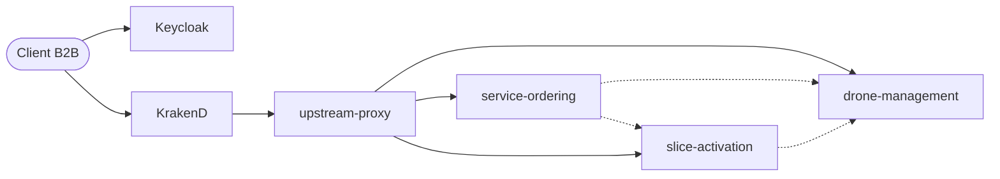

# CanDroneX - Phase 2

LOG430, Automne 2026 - Maëlle Marinier. La Phase 1 (monolithe) est sur l'étiquette git `phase1`.

Trois microservices derrière une API Gateway KrakenD, avec le Keycloak fourni :

- `drone-management-service` : UC-02, enregistrement des drones
- `service-ordering-service` : UC-04, commandes et catalogue
- `slice-activation-service` : UC-06, activation des slices avec le `MockOpen5GSAdapter`

Chaque service a sa base MySQL. Seuls la passerelle (8080), Keycloak (8081) et Swagger UI (8082) sont exposés.



## Démarrer

Copier `.env.example` en `.env` et remplir les mots de passe et les secrets, puis :

```bash
docker compose up --build
```

`docker compose down -v` remet les bases à zéro. Les contrats OpenAPI sont sur http://localhost:8082.

## Obtenir un jeton

Bash (remplacer `<secret>` par `INSPECTRA_DEMO_SECRET` du `.env`) :

```bash
curl -X POST http://localhost:8081/realms/candronex/protocol/openid-connect/token -d grant_type=client_credentials -d client_id=inspectra-demo -d client_secret=<secret>
```

PowerShell (lit le secret dans `.env`) :

```powershell
$secret = (Select-String -Path .env -Pattern '^INSPECTRA_DEMO_SECRET=(.*)').Matches.Groups[1].Value; (Invoke-RestMethod -Method Post -Uri http://localhost:8081/realms/candronex/protocol/openid-connect/token -Body @{grant_type='client_credentials'; client_id='inspectra-demo'; client_secret=$secret}).access_token
```

## Scénario bout en bout

```bash
pip install -r requirements.txt
python scripts/demo.py
python scripts/demo.py --failure
```

Le script obtient un jeton, enregistre un drone, commande C2 et Imagerie, attend que les deux services soient ACTIVE et vérifie les cas d'erreur (401, 400, 422, 404 entre clients, rejeu). `--failure` relance le service des slices avec `MOCK_FAILURE_RATE=1`.

Pour suivre une commande dans les journaux : `docker compose logs | grep <orderId>`.

## Tests

```bash
python -m pytest
```

Pas besoin de Docker : les tests d'intégration lancent les trois services en local avec des dépôts en mémoire.

## Mesures

```bash
docker compose down -v
docker compose up -d --build
python load-tests/run_measurement.py
```

k6 tourne dans un conteneur et passe par la passerelle (1 min de montée, 5 min à 600 ops/s). Le P95 d'activation est calculé avec `load-tests/sql/p95_activation_delay.sql`. Les résultats sont dans `results/`.
